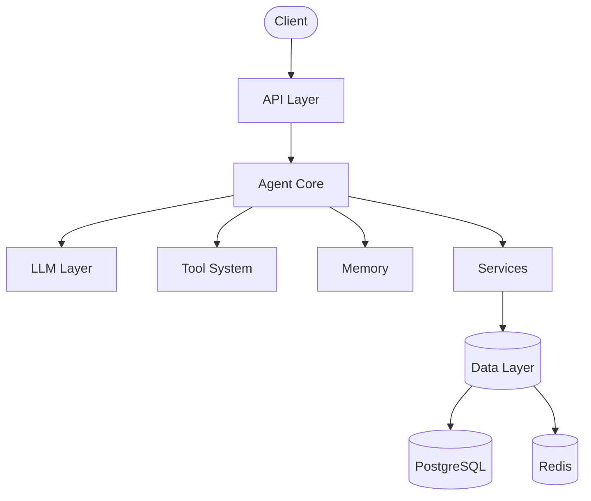

<div align="center">

# ⚡ Force — Nuv Agent

**An engineering-focused AI agent system, built from the ground up.**


</div>

---

## 📖 Overview

**Force** is a hands-on project to explore and build the architecture behind modern agentic systems: the execution loop, tool calling, memory, context management, orchestration, evaluation, and the operational infrastructure needed to run agents in production.

Instead of starting with a framework, Force starts with first principles. Every component is built, understood, and tested before any abstraction is adopted.

---

## 🎯 Goals

Learn by building each of the following:

| Area | Topics |
|------|--------|
| 🧠 **Core Foundations** | Agents · Agent Loop · Harness · System Prompt · Prompting |
| 🛠️ **Capabilities** | Tool Calling (function calling) · Skills · MCP |
| 🗂️ **Context & Memory** | Context Window · Context Engineering · Memory (short & long term) |
| 🕸️ **Orchestration** | Orchestration · Subagents · Multi-Agent Systems · A2A (agent-to-agent) · State Graphs · Routing (router models) |
| 🛡️ **Safety & Control** | Guardrails · Sandboxing · Human-in-the-Loop |
| 📊 **Quality & Operations** | Evals · Observability (tracing) |
| 🧪 **Workflow** | Spec-Driven Development · Git Worktrees |

---

## 🧰 Technology Stack

<p>
  
  
  
  
  
  
  
  
</p>

| Technology | Purpose |
|------------|---------|
| **Python** | Core language |
| **FastAPI** | API layer |
| **Pydantic** | Data validation and typed schemas |
| **PostgreSQL** | Persistent storage (long-term memory, state, traces) |
| **Redis** | Caching, short-term memory, and queues |
| **pytest** | Unit, integration, and end-to-end testing |
| **Docker** | Reproducible environments and sandboxing |
| **LLM SDK** | Model access and tool calling |

---

## 🏗️ Architecture

> Initial architectural direction. It will evolve as the milestones progress.



---

## 📁 Repository Structure

```text
force-nuv-agent/
├── docs/
│   ├── architecture/     # System design and diagrams
│   ├── decisions/        # Architecture Decision Records (ADRs)
│   └── development/      # Development guides
├── scripts/              # Utility and automation scripts
├── src/
│   └── force/            # Main package
└── tests/
    ├── e2e/              # End-to-end tests
    ├── integration/      # Integration tests
    └── unit/             # Unit tests
```

---

## 🗺️ Development Roadmap

| # | Milestone | Main Objective | Status |
|---|-----------|----------------|:------:|
| M0 | **Foundation** | Set up project structure, Python, GitHub, testing, linting, and CI. | 🚧 |
| M1 | **LLM & Prompting** | Integrate an LLM, system prompts, and prompting techniques. | ⏳ |
| M2 | **Agent Core** | Build the first agent. | ⏳ |
| M3 | **Agent Loop** | Implement the decide → act → observe cycle. | ⏳ |
| M4 | **Tool Calling** | Let the agent select and execute tools. | ⏳ |
| M5 | **Harness** | Build the runtime that controls agent execution. | ⏳ |
| M6 | **Sandboxing** | Isolate executions and restrict permissions. | ⏳ |
| M7 | **Context Engineering** | Manage tokens, relevant context, and context windows. | ⏳ |
| M8 | **Memory** | Implement short-term and long-term memory. | ⏳ |
| M9 | **Skills** | Create reusable capabilities and instructions. | ⏳ |
| M10 | **MCP** | Integrate tools and resources via the Model Context Protocol. | ⏳ |
| M11 | **State Graphs** | Model execution flows with states and transitions. | ⏳ |
| M12 | **Routing** | Route tasks to the right model, tool, or agent. | ⏳ |
| M13 | **Subagents** | Create specialized agents and learn to delegate. | ⏳ |
| M14 | **Orchestration** | Coordinate the execution of multiple agents. | ⏳ |
| M15 | **Multi-Agent Systems** | Build systems where several agents collaborate. | ⏳ |
| M16 | **A2A** | Enable communication between independent agents. | ⏳ |
| M17 | **Spec-Driven Development** | Build features from specifications and acceptance criteria. | ⏳ |
| M18 | **Worktrees** | Isolate parallel work with Git worktrees. | ⏳ |
| M19 | **Evals** | Measure performance, quality, and task success. | ⏳ |
| M20 | **Guardrails** | Apply safety policies, validations, and restrictions. | ⏳ |
| M21 | **Human-in-the-Loop** | Add approvals and human intervention. | ⏳ |
| M22 | **Observability** | Implement logs, metrics, and tracing to diagnose runs. | ⏳ |
| 🏁 | **Production-Ready Agent** | Integrate, evaluate, and document the complete system. | ⏳ |

**Legend:** ✅ Done · 🚧 In progress · ⏳ Planned

---

## 🧭 Development Principles

- **Build before abstraction.** Write it by hand first, generalize later.
- **Understand before adopting frameworks.** Know what a tool does before depending on it.
- **Keep the Agent Core framework-independent** where practical.
- **Test behavior, not implementation details.**
- **Document architectural decisions** (see `docs/decisions/`).
- **Introduce complexity only when justified.**
- **Keep infrastructure replaceable** where possible.
- **Never implement features just for demonstration.**

---

## 📌 Project Status

| | |
|---|---|
| **Current milestone** | M0 — Project Foundation |
| **Status** | 🚧 In progress |

---

<div align="center">

Built with curiosity and a lot of tests. 🧪

</div>